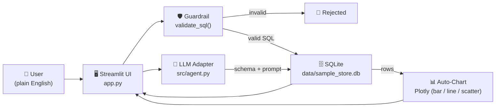

# 📊 Conversational SQL & Automated BI Agent

> Talk to your database in plain English. Get the SQL, the data, and a chart — safely.

An opinionated reference implementation of a **text-to-SQL + automated BI** agent built with
**Streamlit**, **LangChain**, **Plotly**, and **SQLite**.

[](https://github.com/YOUR_USERNAME/sql-bi-agent/actions/workflows/ci.yml)

---

## ✨ Features

| Capability | Description |
|------------|-------------|
| 🗣️ **Conversational text-to-SQL** | Ask natural-language questions; an LLM writes SQLite SQL for you. |
| 🛡️ **Guardrail-first execution** | SELECT-only enforcement + keyword blocklist (`DROP`, `DELETE`, `UPDATE`, …). |
| 🔍 **Transparent queries** | Every answer shows the generated SQL in an expander. |
| 📈 **Auto-charting** | Detects numeric / date / categorical columns and picks bar, line, or scatter. |
| 🧠 **Conversational memory** | Follow-up questions reuse recent context. |
| 💾 **CSV export** | Download any result set with one click. |
| 🔌 **Provider-agnostic** | Works with OpenAI, Azure OpenAI, Ollama, vLLM, or any OpenAI-compatible endpoint. |

---

## 🏗️ Architecture



### Request lifecycle

1. **User prompt** enters the Streamlit chat input.
2. **Schema introspection** (`PRAGMA table_info` + sample rows) is injected into the system prompt.
3. **LLM** (`src/agent.py`) returns a candidate SQL statement.
4. **Guardrail** (`src/guardrails.py`) rejects anything that is not `SELECT` / `WITH`
   or contains forbidden keywords.
5. **SQLite** executes the read-only query and returns a `pandas.DataFrame`.
6. **Chart selector** profiles the DataFrame's dtypes and renders an appropriate Plotly figure.
7. **UI** displays the SQL, the data preview, the chart, and a CSV download button.

---

## 📁 Project structure

```
sql-bi-agent/
├── .github/
│   └── workflows/
│       └── ci.yml              # Lint + syntax-check GitHub Action
├── data/
│   └── .gitkeep                # sample_store.db lives here at runtime (gitignored)
├── src/
│   ├── __init__.py
│   ├── database.py             # Connection, schema, seeding, queries
│   ├── guardrails.py           # SQL safety validator
│   └── agent.py                # LLM text-to-SQL + auto-chart
├── .gitignore
├── init_db.py                  # CLI: seed the SQLite database
├── requirements.txt
├── app.py                      # Streamlit entrypoint
└── README.md
```

---

## 🚀 Quickstart

```bash
# 1) Clone
git clone https://github.com/YOUR_USERNAME/sql-bi-agent.git
cd sql-bi-agent

# 2) Install dependencies (use a venv)
python -m venv venv
source venv/bin/activate         # Windows: venv\Scripts\activate
pip install -r requirements.txt

# 3) Create & seed the sample SQLite database
python init_db.py

# 4) Launch the app
streamlit run app.py
```

Open the URL Streamlit prints (default `http://localhost:8501`), paste your OpenAI API key
in the sidebar, and start asking questions.

---

## 🧪 Example questions

- *What are the top 10 best-selling products by total revenue?*
- *Show monthly revenue trend for 2023.*
- *Which countries have the most customers?*
- *Average order value by product category.*
- *Top 5 customers by total spend.*
- *Distribution of order statuses.*

---

## 🔒 Security model

The guardrail in `src/guardrails.py::validate_sql` enforces four rules:

1. Query must be non-empty.
2. Exactly one statement (no stacked `;` injections).
3. Must start with `SELECT` or `WITH`.
4. Must not contain any of: `DROP`, `DELETE`, `UPDATE`, `INSERT`, `ALTER`, `CREATE`,
   `TRUNCATE`, `REPLACE`, `ATTACH`, `DETACH`, `PRAGMA`, `VACUUM`, `GRANT`, `REVOKE`,
   `EXEC`, `EXECUTE`, `MERGE`, `CALL`, `BEGIN`, `COMMIT`.

> ⚠️ **Production hardening tips**
> - Connect with a **read-only** database user (or a replica / warehouse role).
> - Add a **query timeout** and keep the **row cap** (2 000 rows by default).
> - Log every generated SQL for audit.
> - Add **Row-Level Security** if your backing store supports it.

---

## ☁️ Deploy on Streamlit Community Cloud

1. Push this repo to GitHub (public).
2. Go to <https://share.streamlit.io> → **New app**.
3. Select your repo, branch `main`, main file `app.py`.
4. In **Advanced settings → Secrets**, add:
   ```toml
   OPENAI_API_KEY = "sk-..."
   ```
   The app reads `OPENAI_API_KEY` from `st.secrets` automatically if the sidebar is empty.
5. **Important:** Since the SQLite DB is gitignored, add a one-line bootstrap to your
   deployment or commit a pre-built `data/sample_store.db`. The simplest option is to
   run `python init_db.py` once locally, then force-add the file:
   ```bash
   git add -f data/sample_store.db
   git commit -m "chore: ship pre-seeded demo database"
   git push
   ```
6. Click **Deploy**. Share the URL. 🎉

---

## 🛠️ Customization

| What | Where |
|------|-------|
| Point at your own DB | Change `DB_PATH` in `src/database.py`. |
| Different LLM provider | Set the *Base URL* field in the sidebar (Ollama, vLLM, Azure, …). |
| Chart heuristics | `auto_chart()` and `classify_columns()` in `src/agent.py`. |
| Guardrail rules | `FORBIDDEN_KEYWORDS` and `validate_sql()` in `src/guardrails.py`. |
| Prompt / few-shot examples | `SYSTEM_PROMPT` in `src/agent.py`. |

---

## 🧑‍💻 Development

```bash
ruff check .            # lint
python -m compileall .  # syntax check
python init_db.py       # rebuild the demo DB
```

---

## 📜 License

MIT — use it, fork it, ship it.