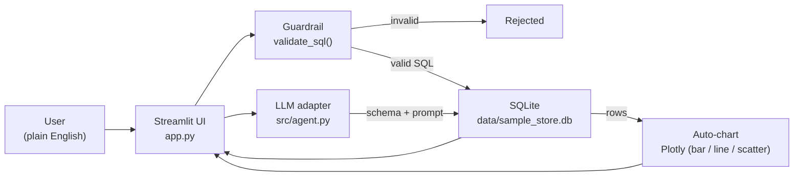

# Conversational SQL & Automated BI Agent

A text-to-SQL and automated business-intelligence agent. Ask questions in plain English, review
the generated SQL, run it safely against a local SQLite database, and get an interactive chart
back — all in a single Streamlit app.

Built with **Streamlit**, **LangChain**, **Plotly**, and **SQLite**.

[](https://github.com/im3li/sql-bi-agent/actions/workflows/ci.yml)
[](https://www.python.org/downloads/)
[](LICENSE)

---

## Overview

The app converts a natural-language question into a SQLite `SELECT` statement using an
LLM, validates the SQL against a strict guardrail, executes it against a local database, and
renders the result as a data table and an auto-selected Plotly chart.

The default provider is [Groq](https://console.groq.com) (free tier available), but any
OpenAI-compatible endpoint works — OpenAI, Azure OpenAI, Google Gemini, Ollama, vLLM, and
others. The provider is selected from a dropdown in the sidebar.

---

## Features

| Capability | Description |
|------------|-------------|
| Conversational text-to-SQL | Natural-language questions are translated to SQLite SQL by an LLM. |
| Strict SQL guardrail | Only `SELECT` / `WITH` statements are permitted; destructive keywords are blocked. |
| Query transparency | Every answer exposes the exact SQL that was run, in a collapsible panel. |
| Automatic charts | Column types are inspected and an appropriate Plotly chart (bar, line, or scatter) is chosen. |
| Follow-up suggestions | After each answer, three context-aware follow-up questions are generated for one-click drilling. |
| Query history | The last ten questions are kept in the sidebar and can be re-run with one click. |
| Result controls | Adjustable row limit per query; per-result CSV download; full session export as JSON. |
| Provider-agnostic | Works with Groq, OpenAI, Azure OpenAI, Google Gemini, Ollama, vLLM, or any OpenAI-compatible endpoint. |

---

## Architecture



### Request lifecycle

1. The user submits a question via the Streamlit chat input.
2. The database schema (via `PRAGMA table_info`) and a few sample rows are embedded in the system prompt.
3. The LLM (`src/agent.py`) returns a candidate SQLite query.
4. The guardrail (`src/guardrails.py`) rejects anything that is not a single `SELECT` or `WITH`
   statement or that contains forbidden keywords.
5. SQLite executes the read-only query and returns a `pandas.DataFrame`.
6. Column types are profiled and an appropriate Plotly chart is rendered.
7. The UI displays the SQL, a data preview, the chart, and a CSV download button.

---

## Project structure

```
sql-bi-agent/
├── .github/
│   └── workflows/
│       └── ci.yml              # GitHub Actions: ruff lint + syntax check
├── .streamlit/
│   └── config.toml             # Streamlit internal theme (dark base)
├── assets/
│   └── logo.png                # Favicon + sidebar brand mark
├── data/
│   ├── .gitkeep
│   └── sample_store.db         # Pre-seeded demo database (committed for deployment)
├── src/
│   ├── __init__.py
│   ├── agent.py                # LLM text-to-SQL + automatic chart selection
│   ├── database.py             # Connection, schema introspection, query execution
│   └── guardrails.py           # SQL safety validator
├── .gitignore
├── app.py                      # Streamlit entry point
├── init_db.py                  # CLI: create and seed the SQLite database
├── pyproject.toml              # Ruff configuration
├── requirements.txt
└── README.md
```

---

## Quickstart

### Prerequisites

- Python 3.10 or higher
- A free API key from [Groq](https://console.groq.com/keys) (recommended) or any
  OpenAI-compatible provider

### Local setup

```bash
# 1. Clone the repository
git clone https://github.com/im3li/sql-bi-agent.git
cd sql-bi-agent

# 2. Create and activate a virtual environment
python -m venv venv
source venv/bin/activate          # Windows: venv\Scripts\activate

# 3. Install dependencies
pip install -r requirements.txt

# 4. Create and seed the sample database
python init_db.py

# 5. Launch the app
streamlit run app.py
```

Open the URL Streamlit prints (default: `http://localhost:8501`), select a provider in the
sidebar, paste your API key, and start asking questions.

### API key configuration

You can provide the API key in one of three ways, in order of priority:

1. **Sidebar** — paste it into the *API Key* field. Stored only in session state.
2. **Environment variable** — export `GROQ_API_KEY` or `OPENAI_API_KEY` before launching.
3. **Streamlit secrets** — create `.streamlit/secrets.toml`:

   ```toml
   GROQ_API_KEY  = "gsk_..."
   GROQ_API_BASE = "https://api.groq.com/openai/v1"
   GROQ_MODEL    = "openai/gpt-oss-120b"
   ```

   This file is git-ignored and never uploaded.

---

## Example questions

- What are the top 5 best-selling products by total revenue?
- Show monthly revenue trend for 2023.
- Which countries have the most customers?
- What is the average order value by product category?
- Who are the top 5 customers by total spend?
- Show the distribution of order statuses.

---

## Security model

The SQL guardrail (`src/guardrails.py::validate_sql`) enforces four rules:

1. The query must be non-empty.
2. Exactly one statement is allowed (no stacked `;` injections).
3. The query must begin with `SELECT` or `WITH`.
4. The following keywords are blocked entirely: `DROP`, `DELETE`, `UPDATE`, `INSERT`,
   `ALTER`, `CREATE`, `TRUNCATE`, `REPLACE`, `ATTACH`, `DETACH`, `PRAGMA`, `VACUUM`,
   `GRANT`, `REVOKE`, `EXEC`, `EXECUTE`, `MERGE`, `CALL`, `BEGIN`, `COMMIT`.

### Production hardening

The guardrail blocks the most common attack vectors, but for a real deployment you should
also:

- Connect using a **read-only** database user, or point at a replica.
- Enforce a **query timeout** at the database level.
- Keep the application-level **row cap** (default 2 000 rows).
- Log every generated SQL statement for auditing.
- Add row-level security if the backing store supports it.

---

## Deployment on Streamlit Community Cloud

1. Push the repository to GitHub (must be public for the free tier).
2. Go to <https://share.streamlit.io> and click **New app**.
3. Select the repository, branch `main`, and main file `app.py`.
4. Under **Advanced settings → Secrets**, add:

   ```toml
   GROQ_API_KEY  = "gsk_..."
   GROQ_API_BASE = "https://api.groq.com/openai/v1"
   GROQ_MODEL    = "openai/gpt-oss-120b"
   ```

5. Ensure `data/sample_store.db` is committed (it is force-added by `.gitignore` bypass):

   ```bash
   git add -f data/sample_store.db
   git commit -m "chore: ship pre-seeded demo database"
   git push
   ```

6. Click **Deploy**. The app will be available at
   `https://sql-bi-agent-<username>.streamlit.app`.

---

## Customization

| What | Where |
|------|-------|
| Point at a different database | Change `DB_PATH` in `src/database.py`. |
| Change LLM provider | Select it in the sidebar; the base URL and model auto-fill. |
| Tune chart selection | `auto_chart()` and `classify_columns()` in `src/agent.py`. |
| Adjust guardrail rules | `FORBIDDEN_KEYWORDS` and `validate_sql()` in `src/guardrails.py`. |
| Edit the system prompt | `SYSTEM_PROMPT` in `src/agent.py`. |

---

## Development

```bash
ruff check .              # lint
ruff format .             # format
python -m compileall .    # syntax check
python init_db.py         # rebuild the demo database
```

The GitHub Actions workflow runs `ruff check` and a byte-compile on every push to `main`.

---

## License

MIT. See [LICENSE](LICENSE) for details.
